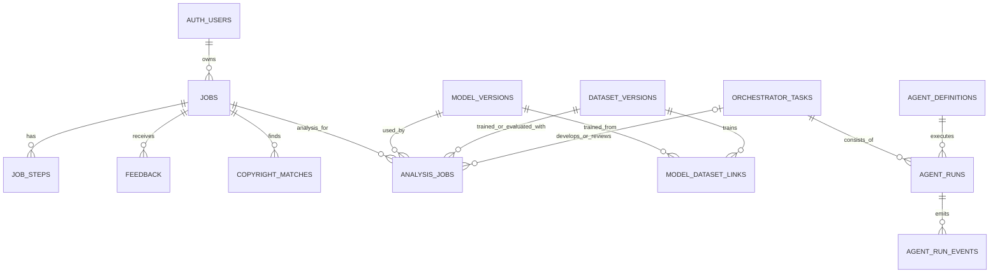

# LAVCCA DB foundation — proposed ERD and version/agent lineage (design review, 2026-11-25)

**State: PROPOSAL, not approved schema and not migrated.** Baseline migration `0001_jobs.sql` already defines five tables. Protect existing `jobs` API, worker and user-feedback routes; extend compatibly rather than renaming `jobs` or changing its string primary key.

## Relationship map

The final optional relation from orchestration tasks to analysis jobs is **conceptual** and may be deliberately omitted at implementation time: code-development tasks and customer-video analysis jobs are different security domains. No cross-domain FK is permitted without PM approval.

## Proposed tables and safety invariants

| Proposed entity | Identity and key columns | Required constraints |
|---|---|---|
| `model_versions` | UUID PK; model_family; version; s3 artifact URI; artifact SHA256; embedding provider/version; vector-index URI; created_at | UNIQUE(model_family, version); digest immutable once released |
| `dataset_versions` | UUID PK; dataset_family; version; manifest S3 URI; digest; taxonomy_version; created_at | UNIQUE(dataset_family, version); dataset lineage immutable |
| `model_dataset_links` | UUID PK or composite(model_version_id,dataset_version_id,role); source_role(train/eval/golden); link time | FK both versions, UNIQUE on relation+role |
| `analysis_jobs` | UUID PK; `job_id` TEXT FK → existing `jobs.id`; model_version_id FK; dataset_version_id FK; pipeline snapshot and status | preserve jobs API; new provenance immutable after completion; no raw customer content copied |
| `agent_definitions` | Stable agent_key PK; role; version; enabled state | no credentials in DB; changes audited |
| `orchestrator_tasks` | Task ID PK; repo; base_commit; task_sha256; approval reference (not OTP); status; created_at | task SHA immutable; task IDs unique; PM gate remains external |
| `agent_runs` | UUID PK; task_id FK; agent_key FK; attempt/round; started/ended; verdict; diff SHA; charge estimate | UNIQUE(task_id,agent_key,attempt); no secrets/prompts by default |
| `agent_run_events` | bigint identity PK; run_id FK; event sequence; event_type; occurred_at; sanitized metadata JSONB | UNIQUE(run_id,event_seq); append-only audit intent |

`analysis_findings` should reference `analysis_jobs.id` and carry taxonomy identifier, start/end timestamp, model version via its parent job, confidence, reviewer disposition. Exact table shape must be reconciled with existing S3 reports before implementation.

## Auth and access design

- End-user APIs continue to use `jobs` / `feedback` RLS and the narrow grants already in `0001_jobs.sql`.
- New provenance and orchestration tables: default **RLS ON**, NO grants to anon/authenticated, authorized back-end service role only where required.
- All future grants must explicitly exclude untrusted `TRUNCATE`, `REFERENCES`, `TRIGGER`, `MAINTAIN`, `WITH GRANT OPTION`.
- Agent audit metadata must omit access tokens, OTP, credential material, full prompts and raw customer uploads.
- Ownership and service_role BYPASSRLS must be tested against a throwaway Supabase-compatible Postgres, not inferred from parser output.

## Backward-compatibility migration plan

1. Snapshot current dev schema/privileges **read-only**; reconcile latest `main` with dev schema.
2. Create version and agent tables as a new numbered additive migration. Do not drop or rename existing five tables.
3. Deploy backend code supporting old nullable version fields and new normalized version links; backfill **only with verified actual lineage**, never guess a model/dataset version.
4. Add constraints for future completed analysis jobs once backfill and API compatibility are proven.
5. Rollback: prefer forward-only corrective migration. Reversal that drops these tables must be restricted to an empty isolated DB; production restoration is from verified backup.
6. Require dual-user RLS denial tests, service-role positive cases, transaction rollback tests, and backup restore verification before PM reviews deployment.

## Decisions PM must ultimately approve

- Should `analysis_jobs` be a 1:1 detailed analysis record for `jobs` or 1:N for re-analysis/version comparison? **Recommended 1:N** and immutable provenance per run.
- Whether to store model↔dataset relationship directly in `analysis_jobs` as dataset_version_id or via the model's training lineage only. **Recommended both**, distinguishing training dataset from the dataset used for retrieval/evaluation.
- Whether code-agent orchestration metadata lives in the customer-facing Supabase project. **Recommended separate restricted schema or database**, not public client-accessible tables.
- Retention windows for audit events and sanitized metadata; no automatic deletion policy until confirmed.

No SQL application, grants or production changes are authorized by this proposal.
